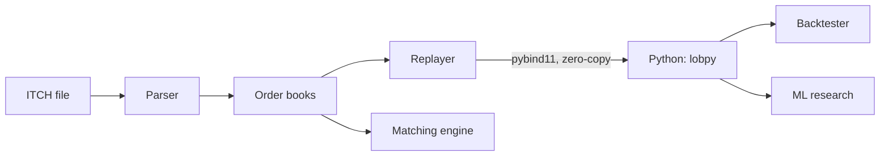
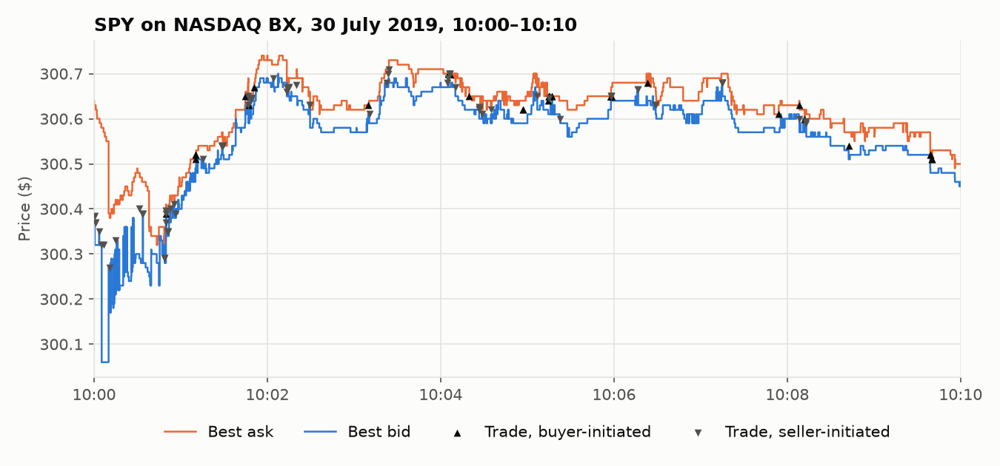

# LOB Research Platform

A C++20 limit order book engine that replays real NASDAQ TotalView-ITCH 5.0 market data, with
Python bindings, an event-driven backtester and a machine-learning order-flow signal.

[](https://github.com/MaxS140M/lob-research-platform/actions/workflows/ci.yml)
[](LICENSE)

## Highlights

- **Fast:** replays a full trading day (28.7M messages, 8,850 stocks) at **28M messages/sec**
  on one core of an AMD Ryzen 5 5600X.
- **Optimised step by step:** p99 latency to add an order fell from **311 ns to 160 ns**, and
  replay got **2.5× faster** than the first version, through cache-friendly data structures
  and a preallocated order pool. Each step was measured.
- **Correct:** five real trading days (175M messages) rebuilt with zero errors. 134 tests (91 C++,
  43 Python) run in CI, including under AddressSanitizer and UndefinedBehaviorSanitizer.
- **Honest research:** a walk-forward validated LightGBM model predicts the next price move
  better than every baseline on an unseen day, and the backtest shows exactly why that edge
  disappears once trading costs are paid.

## Architecture



C++ does the fast work: parsing, order books and matching. Python does the research:
features, models and backtests. More detail in [docs/architecture.md](docs/architecture.md).

## Results


**Speed:** every book update of a real day, timed individually. The optimised engine is
about twice as fast across the whole distribution. See [benchmarks](docs/benchmarks.md).


**Prediction:** on a day never used in development, the model beats guessing (33%) at every
horizon, and is best at 5 seconds.


**Trading:** the predictions make money before costs, but crossing the spread costs far
more. The [research report](docs/research-report.md) explains why, and why it probably
wouldn't work live.


**The data:** SPY's best bid and ask over ten minutes, rebuilt from raw exchange messages,
with every trade marked.

## Quick start

Needs Linux or WSL2, a C++20 compiler, CMake 3.25+, Ninja and Python 3.11+.

```bash
git clone https://github.com/MaxS140M/lob-research-platform.git && cd lob-research-platform

# Build and test the C++ engine
cmake -S . -B build -G Ninja -DCMAKE_BUILD_TYPE=Release
cmake --build build && ctest --test-dir build

# Run it on the small sample file in the repo
./build/itch_stats testdata/sample.itch
./build/book_replay testdata/sample.itch

# Install the Python package (this builds the C++ too) and test it
python3 -m venv .venv && source .venv/bin/activate
pip install ".[dev]" && pytest
```

```python
import lobpy
r = lobpy.Replayer("testdata/sample.itch")
print(lobpy.snapshots_frame(r.snapshots(interval_ns=1_000_000_000, depth=2), r.symbols))
```

To download real NASDAQ data and reproduce every result, see
[docs/getting-started.md](docs/getting-started.md).

## Documentation

| Doc | What's in it |
|---|---|
| [Getting started](docs/getting-started.md) | Setup, real data, and how to run every tool and script |
| [Architecture](docs/architecture.md) | What each part does, and why it's built that way |
| [Benchmarks](docs/benchmarks.md) | Speed results and how they were measured |
| [Backtester](docs/backtest.md) | How fills are simulated, and results of simple strategies |
| [Research report](docs/research-report.md) | The ML study: question, method, results and limitations |
| [Changelog](CHANGELOG.md) | What each release added |

## Design decisions

- **Integer prices.** Prices are kept as whole numbers with 4 implied decimals, exactly as
  NASDAQ sends them, so comparisons and profit calculations are exact. Floats can't
  represent 0.1 exactly.
- **Memory-mapped file.** The parser reads the file through `mmap`: no copying and no
  allocation per message, about 160M messages/sec.
- **A sorted array of price levels, not a tree.** Neighbouring levels sit next to each other
  in memory, the best price is always at the end, and almost all activity is near it.
- **An order pool and an open-addressing hash table.** No `malloc` while trading, and an
  order lookup usually touches a single cache line.
- **Compile-time callbacks.** The parser calls handler methods resolved at compile time, so
  there are no virtual calls on the hot path.
- **Strategies only see the present.** The backtester hands a strategy one event at a time,
  and its orders arrive after a latency delay and wait their turn in the queue.

## Limitations and next steps

- **One small exchange.** The data is NASDAQ BX only, whose books are thin. The full NASDAQ
  feed would be more realistic.
- **Five days.** Enough to show the method, not to prove a strategy works.
- **Simplified costs.** Flat fees and no market impact.
- **Next:** more days and venues, passive execution to earn the spread instead of paying it,
  and labels that account for trading costs. See the
  [research report](docs/research-report.md#6-what-id-do-next).

## Licence

[MIT](LICENSE)
