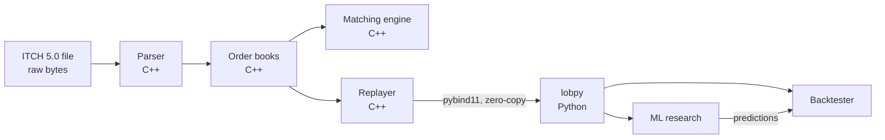

# Architecture

How the project fits together, what each part does, and why it's built that way.

## The big picture

The C++ side does the heavy, fast work: reading the file, rebuilding the order book and
matching orders. The Python side does the research: features, models and backtests. The
pybind11 bindings connect the two, handing data from C++ to NumPy without copying it.

## The parts

| Part | What it does | Code |
|---|---|---|
| **Parser** | Reads the binary ITCH file and turns each message into a struct (add order, execute, cancel, ...) | [itch.hpp](../cpp/include/lob/itch.hpp), [itch_parser.hpp](../cpp/include/lob/itch_parser.hpp) |
| **Memory-mapped file** | Lets the parser read a multi-GB file as if it were already in memory | [mapped_file.hpp](../cpp/include/lob/mapped_file.hpp) |
| **Order book** | Keeps every resting order for one stock, sorted by price, then by arrival time | [order_book.hpp](../cpp/include/lob/order_book.hpp) |
| **Order index** | A fast hash table from order id to the order's slot | [order_index.hpp](../cpp/include/lob/order_index.hpp) |
| **Book builder** | Feeds parsed messages into one order book per stock | [book_builder.hpp](../cpp/include/lob/book_builder.hpp) |
| **Matching engine** | Matches your own orders against the book, best price first, then oldest first | [matching_engine.hpp](../cpp/include/lob/matching_engine.hpp) |
| **Replayer** | Replays a day for chosen stocks and returns snapshots, trades or every book event | [replayer.hpp](../cpp/include/lob/replayer.hpp) |
| **Python bindings** | Exposes the Replayer to Python as `lobpy.Replayer` | [bindings.cpp](../cpp/src/bindings.cpp) |
| **Backtester** | Replays events to a strategy and simulates realistic fills | [python/lobpy/backtest/](../python/lobpy/backtest/) |
| **Research** | Features, labels, leakage-free validation and models | [python/lobpy/research/](../python/lobpy/research/) |

**Tools** (command-line programs in [cpp/tools/](../cpp/tools/)):
- `itch_stats` counts every message type in a file and times the parser.
- `book_replay` rebuilds every book for a day and checks that it is consistent.

## Key design decisions

**Prices are integers, never floats.**
ITCH sends prices as whole numbers with 4 implied decimals: 1823500 means $182.35. The code
keeps them that way, so comparisons and PnL are exact. With floats, `0.1 + 0.2 != 0.3`, and
two equal prices could compare as different.

**The parser reads the file through `mmap`.**
The operating system maps the file into memory and loads pages as they are touched. There is
no copying into buffers and no per-message allocation. Combined with compile-time callbacks
(below), the parser decodes about 160M messages per second.

**Callbacks are template parameters, not virtual functions.**
The parser takes a "handler" object and calls methods like `on_add_order` on it. Because the
handler type is known at compile time, the compiler inlines those calls. A handler only
implements the callbacks it needs; missing ones are skipped at compile time.

**Price levels are a sorted array, best price at the back.**
- **Why an array:** the first version used `std::map` (a tree). Walking a tree jumps around
  memory, and each jump is a likely cache miss. A sorted `std::vector` keeps levels next to
  each other, and the best price is just `back()`.
- **Searching:** a search starts at the best price, where almost all activity happens.
- **Why not an array indexed directly by price?** One far-away quote would make it millions
  of slots long per stock.

**Orders live in a pool, linked into queues by index.**
- **No allocation:** instead of allocating each order separately, orders sit in one big
  array and are reused, so the hot path never calls `malloc`.
- **The queue:** each price level's queue is a linked list threaded through that array by
  32-bit indices.

**Order lookup uses an open-addressing hash table.**
- **Cache-friendly:** one flat array of slots, so a lookup usually touches one cache line.
  `std::unordered_map` allocates a node per entry and follows pointers instead.
- **Biggest single gain:** this change gave the largest speed-up of all the optimisations.

**Python gets NumPy arrays without copying.**
C++ fills a buffer, then hands ownership of that exact memory to NumPy. Millions of rows
cross from C++ to Python without a single copy, and the replay runs with Python's GIL
released.

**The backtester is event-driven, and strategies only see the present.**
A strategy receives one book update at a time and never gets the data feed itself, so it
can't accidentally look ahead. Orders reach the "exchange" only after a latency delay, and
passive orders wait their turn in the queue.

## How correctness is checked

- **Unit tests:** 91 in C++ (GoogleTest) and 43 in Python (pytest).
- **Differential tests:**
  - The optimised order book is checked against a frozen copy of the simple first version,
    operation by operation.
  - The matching engine is checked against a brute-force model.
- **Real data:** `book_replay` checks five full trading days (175M messages). It finds zero
  anomalies and no crossed books, and every optimisation reproduces the original version's
  book state exactly.
- **No lookahead:** a test scrambles all future data and checks that no earlier feature
  changes.
- **Sanitizers:** CI runs the C++ tests under AddressSanitizer and
  UndefinedBehaviorSanitizer.
