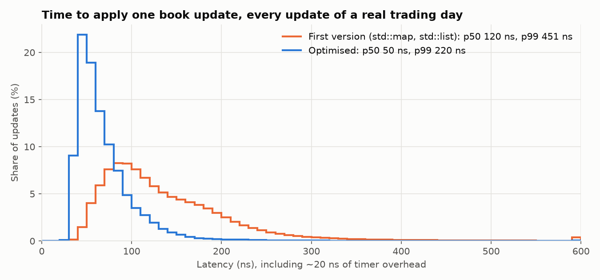

# Benchmarks

How fast the engine is, and how that was measured.

**Machine:** AMD Ryzen 5 5600X (6 cores), WSL2 Ubuntu 24.04, GCC 13.3, `-O3 -march=native`,
pinned to one core.

**Data:** one full NASDAQ BX day (30 July 2019): 28.7M messages, 837 MB, 8,850 stocks.

## Headline: first version vs final version

Both versions run in the same process, with their runs mixed together in random order, so
background noise affects both equally. The table shows the median of 7 runs.

| | First version | Final version | Change |
|---|---:|---:|---:|
| **Full-day replay** (messages per second) | 11.0 M | **27.9 M** | **2.5× faster** |
| Add an order, real data, p50 / p99 | 100 / 311 ns | **50 / 160 ns** | p99 **1.9× lower** |
| Execute an order, p50 / p99 | 130 / 411 ns | 60 / 240 ns | |
| Delete an order, p50 / p99 | 130 / 381 ns | 60 / 220 ns | |

**p50** is the typical case. **p99** is the slowest 1% of updates, which is what trading firms
care about most. All latencies include about 20 ns of timer overhead.

*Every update of the day, timed one by one (5 runs of each version, alternated). The final
version is faster across the whole distribution, not just on average.*

## The parser on its own

| | Time | Per message |
|---|---:|---:|
| Read the full day from disk (cold) | 1.66 s | 58 ns, limited by the disk |
| Decode every field, file already in memory | 0.18 s | **6.3 ns**, about 160M messages/sec |

## How each optimisation helped

Each step was found by profiling with `perf`, changed on its own, and measured. Every version
was rebuilt from its commit and benchmarked in one session.

| Version | Change | Replay speed | Add p50 / p99 (real data) |
|---|---|---:|---:|
| v1 | Simple: `std::map` of price levels, `std::list` of orders, `std::unordered_map` | 10.8 M/s | 100 / 311 ns |
| v2 | Price levels in a sorted array, best price at the end | 14.2 M/s | 80 / 220 ns |
| v3 | Orders in a reusable pool, linked by index (no `malloc`) | 14.3 M/s | 70 / 200 ns |
| v4 | Open-addressing hash table for order lookup | **22.7 M/s** | **50 / 180 ns** |

**What `perf` showed before optimising:**
- **~25%** of the time in `std::unordered_map`
- **~20%** walking the `std::map` tree
- **~7%** in `malloc` and `free`

Those three costs are what v2–v4 removed.

**What's left** is mostly cache misses: each message touches a random order in memory.

**Why the replay speed differs between tables:** the headline uses a minimal replayer, while
the version table goes through the full `BookBuilder`, which also counts anomalies. Separate
runs also vary by a few percent.

## How it was measured

- **Timing single operations:** each one is timed with the CPU's timestamp counter
  (`rdtsc`). A normal clock read takes about 20 ns, too slow for operations this short.
- **Converting to nanoseconds:** ticks are divided by the CPU's fixed timestamp-counter rate
  (3.693 GHz, from `dmesg`). Calibrating against the system clock drifted by up to 9% under
  WSL2, because Windows steers the virtual machine's clock.
- **Resolution:** about 10 ns. Results are rounded to that.
- **Repeats:** every number is the median of 5–7 runs, each after a warm-up.
- **Correctness of every version:** it must rebuild the full day with zero errors and produce
  exactly the same book state, checked after every one of the 28.7M messages.

Raw results are in [bench/](bench/). To run the benchmarks yourself, see
[getting-started.md](getting-started.md#6-benchmarks).
