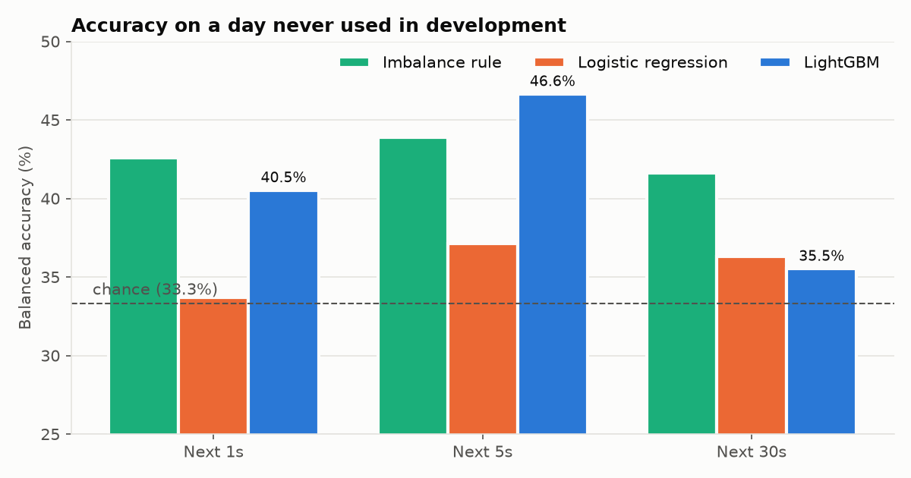
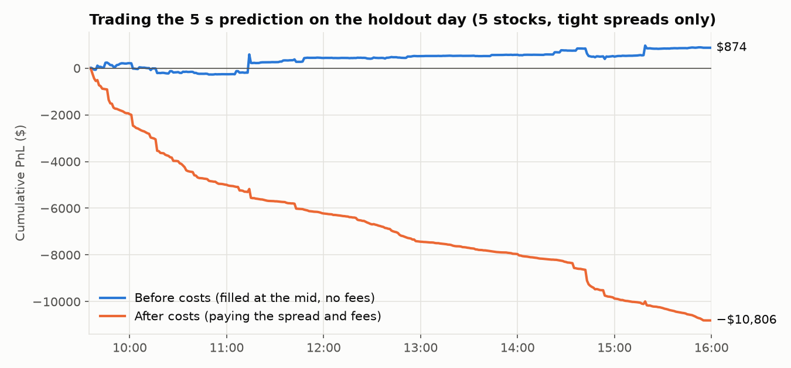

# Research report: can the order book predict short-term price moves?

*A short internal-style note on the ML study. Full numbers are in
[research/tables.md](research/tables.md), and the code is in
[python/lobpy/research/](../python/lobpy/research/).*

## 1. Question

Can features of the order book predict the direction of the next price move over the next
1, 5 or 30 seconds? And if so, can that prediction be traded at a profit once you pay the
spread and fees?

**Short answer: it predicts, but it can't be traded profitably here.** The model beats every
baseline on a day it never saw. But it is most confident exactly when trading is most
expensive. Even when restricted to cheap-to-trade moments, its edge is smaller than the cost
of trading.

## 2. Data

| | |
|---|---|
| Source | NASDAQ BX TotalView-ITCH 5.0, NASDAQ's free sample files |
| Days | 30 Jul, 30 Aug, 30 Oct, 30 Dec 2019 (development) and 30 Jan 2020 (holdout) |
| Stocks | SPY, QQQ, IWM, AAPL, MSFT |
| Messages | 175M across the five days, every one replayed and checked (zero errors) |
| Samples | a snapshot of each book every 250 ms, 09:35–15:55: 1.8M rows for development, 456k for holdout |

## 3. Method

**Features.** Nine numbers per snapshot, all computed only from data at or before that
moment:

| Feature | In plain words |
|---|---|
| Order book imbalance (top level and 5 levels) | Are more shares waiting to buy or to sell? |
| Spread | How far apart the best bid and ask are |
| Microprice offset | Which way a size-weighted "fair price" leans |
| Order flow imbalance (last snapshot, last second) | Are buyers or sellers adding pressure right now? |
| Trade flow | Were the last 20 trades mostly buyers or sellers hitting? |
| Volatility, momentum | How much, and which way, the price moved in the last few seconds |

**Label.** Did the mid-price go down, stay flat or go up over the next 1 s, 5 s or 30 s?

**Validation, built to avoid fooling myself:**
- **Never shuffle.** Training data always comes *before* test data.
- **Walk forward.** Train on everything up to a half-day, test on the next half-day, then
  move forward. That gives 7 tests across the four development days.
- **Embargo.** Training rows close to the start of a test period are dropped, so no training
  label can "see" prices inside the test period.
- **One untouched day.** 30 Jan 2020 was only used once, at the end.
- **No tuning on test data.** Model settings were fixed in advance.
- **A test that proves there is no lookahead.** It scrambles all future data and checks that
  no earlier feature changes.

**Models, simplest first:**
1. Always predict the most common outcome.
2. "Imbalance > 0 means up."
3. Logistic regression.
4. LightGBM, a gradient-boosted tree model.

## 4. Results

### The model genuinely predicts

**Balanced accuracy** is the average of how often each outcome (down, flat, up) is
correctly called. Guessing scores 33.3%. On the holdout day:

| Horizon | Best baseline | LightGBM | Log-loss (lower is better), majority class → LightGBM |
|---|---:|---:|---:|
| 1 s | 42.6% (imbalance rule) | 40.5% | 1.151 → **1.034** |
| 5 s | 43.9% (imbalance rule) | **46.6%** | 1.062 → **0.978** |
| 30 s | 41.6% (imbalance rule) | 35.5% | 0.898 → **0.874** |

- **LightGBM has the best log-loss at every horizon.** Log-loss measures how good its
  probabilities are, not just its top guess. It also beat the baseline in 20 of 21
  walk-forward tests.
- **The simple imbalance rule is a strong baseline.** On balanced accuracy it even beats
  LightGBM at 1 s and 30 s, though its probabilities are worse.
- **Logistic regression barely beats guessing.** The patterns are non-linear.

### But its confidence comes from the wrong place

The spread turned out to be one of the model's most useful features: the top one at 5 s and
30 s. When I looked at the moments the model was confident (over 60% sure of up or down):

| Horizon | Median spread when confident | Median spread normally | Right when confident |
|---|---:|---:|---:|
| 1 s | 55 ticks ($0.55) | 3 ticks | 84% |
| 5 s | 47 ticks | 3 ticks | 79% |
| 30 s | 56 ticks | 3 ticks | 72% |

On BX's thin books, a wide spread usually means one side has briefly run out of orders. The
price then predictably snaps back when it refills. **The model learned that correctly, but
trading it means paying a spread of about 50 cents.**

### Trading it: before and after costs

The predictions were traded in the [backtester](backtest.md):
- buy when the predicted chance of an up move is above the threshold (sell for down)
- hold for the horizon, then exit
- 100 shares, 100 µs latency, $0.003 per share fees

Results for the five stocks on the holdout day, at threshold 0.6:

| Horizon | Trades | Before costs | After costs |
|---|---:|---:|---:|
| 1 s | 611 | +$325 | −$136,230 |
| 5 s | 1,805 | −$5,330 | −$232,299 |
| 30 s | 653 | +$273 | −$76,898 |

Almost all the loss is the spread.

**The fix: only trade when the spread is at most 2 ticks.** In those moments the model has
to rely on real order-flow information instead:
- **Feature use shifts:** imbalance and trade flow become its main features, and the spread
  drops to zero.
- **1 s:** a small but real edge, beating the baseline in 7/7 walk-forward tests.
- **5 s:** a smaller edge, also 7/7.
- **30 s:** no edge (1/7).

**Even then, costs win.** At 5 s (threshold 0.5) the strategy makes **+$874 before costs**
over 1,745 round trips. It **loses $10,806 after costs**, because each round trip crosses the
spread twice.

*Caveat:* this second variant was designed after seeing the first holdout result, so its
holdout numbers are a second look at that day. The walk-forward results on the development
days are the fair evidence.

## 5. Why this probably wouldn't work live

Even the parts that look good should be treated with suspicion:

- **Too little data.** Five days and five stocks. One busy day (the holdout had nearly twice
  the usual message count) can change the results a lot. A real study would use months.
- **One small exchange.** BX is a small venue with thin books. A real trader routes orders to
  whichever exchange has the best price, where spreads are tighter and the patterns differ.
- **Simplified costs.** Fees are a flat $0.003 per share. Real fees depend on the venue, the
  volume tier and whether you add or remove liquidity. BX actually pays you to remove
  liquidity.
- **No market impact.** The backtest assumes our orders don't change anyone else's
  behaviour.
- **Faster competitors.** The edge lives in the first second. Firms with co-located servers
  react in microseconds and would take it first. My 100 µs latency is optimistic for
  anything but a co-located setup.
- **Queue position is estimated.** It is modelled carefully, but hidden orders and orders on
  other exchanges can change who really gets filled.

## 6. What I'd do next

- **More data:** months of days, and the full NASDAQ feed instead of BX, to test whether the
  1–5 s edge is stable.
- **Cheaper execution:** try waiting in the queue (earning the spread) instead of crossing
  it, and measure adverse selection properly.
- **Better labels:** predict "will this trade be profitable after crossing the spread?"
  rather than just direction.
- **Better queue modelling:** estimate where hidden orders sit, and test against real fills.
- **Other horizons:** event-based horizons (the next 10, 50 or 100 book updates) instead of
  clock time.
