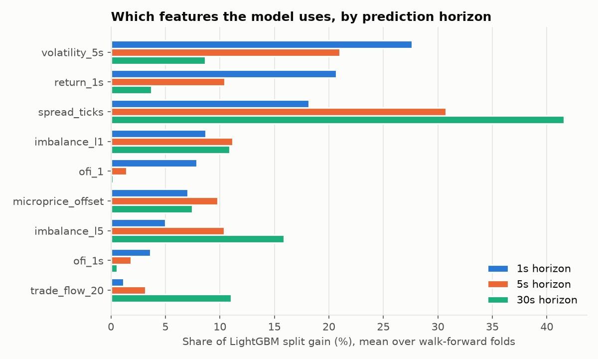
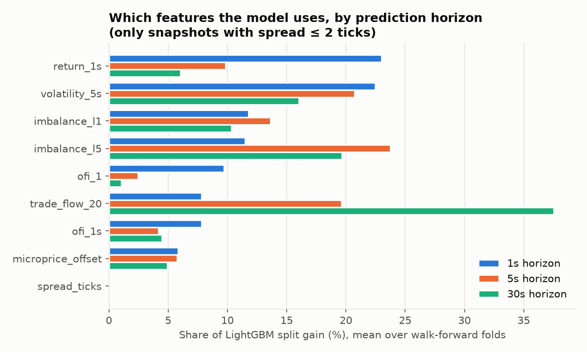

# ML signal: predicting short-term price moves from the order book

**Question:** can order book features predict the direction of the next mid-price move, and
can that prediction be traded once costs are paid?

**Short answer:** they predict it, out of sample and on a day never touched during
development. But the model is most confident exactly where trading is prohibitively
expensive. Restricting it to tradeable states leaves a small, real edge at 1–5 seconds that
is still smaller than the cost of crossing the spread.

| | |
|---|---|
| **Data** | NASDAQ BX TotalView-ITCH 5.0, five trading days |
| **Development days** (walk-forward only) | 30 Jul, 30 Aug, 30 Oct and 30 Dec 2019 |
| **Holdout day** (used once) | 30 Jan 2020 |
| **Symbols** | SPY, QQQ, IWM, AAPL, MSFT |
| **Sampling** | book snapshots every 250 ms, 09:35–15:55 |
| **Rows** | 1.82M development, 456k holdout |
| **Validation** | every day passes `book_replay` with 0 anomalies (175M messages in total) |

Reproduce with `python3 scripts/run_research.py <data-dir> docs/research/results.json
docs/img/feature_importance.png`, about 4.5 minutes on 12 cores. Set
`LOB_MAX_SPREAD_TICKS=2` for the cost-aware variant. Raw results:
[results.json](research/results.json) and
[results_tight_spread.json](research/results_tight_spread.json).

## Method

### Features (6.1)

All computed in [`lobpy.research.features`](../python/lobpy/research/features.py):

| Feature | Definition |
|---|---|
| `imbalance_l1` | (bid size − ask size) / (bid size + ask size) at the top level |
| `imbalance_l5` | The same over 5 levels, each weighted by 1 / (1 + ticks from the mid) |
| `spread_ticks` | Ask − bid, in cents |
| `microprice_offset` | (microprice − mid) / spread, where microprice = (bid × ask size + ask × bid size) / (bid size + ask size) |
| `ofi_1`, `ofi_1s` | Order flow imbalance (Cont, Kukanov & Stoikov) since the previous snapshot and over the last second, scaled by top-level depth |
| `trade_flow_20` | (buy − sell initiated volume) / volume over the last 20 trades, using the aggressor side from the C++ engine |
| `volatility_5s` | Std of mid changes (bps) over the last 5 seconds |
| `return_1s` | Mid change (bps) over the last second |

**No lookahead, proven by a test.** Every feature at time *t* uses only snapshots and trades
at or before *t*. [`test_research.py`](../python/tests/test_research.py) checks this
directly: it scrambles all data after a cut-off, rebuilds the features, and asserts that
nothing at or before the cut-off changed.

### Label (6.2)

Direction of the mid-price over the next **1 s, 5 s and 30 s**: down, flat or up. The class
mix shifts sharply with the horizon. At 1 s most moves are flat; at 30 s almost none are.
So accuracy alone is misleading, and every table also reports **balanced accuracy** (mean
recall over the three classes, where 33.3% is chance) and **log-loss**.

### Validation without leakage (6.3)

- **Never shuffled.** Rows stay in time order.
- **Walk-forward, expanding window.** Each development day is split into morning and
  afternoon blocks, making 8 blocks. Each fold trains on all earlier blocks and tests on the
  next, giving **7 folds**.
- **Embargo.** Training rows within one label horizon of the test block's start (on the same
  day) are dropped, so no training label can see prices inside the test block. A unit test
  checks the gap; it caught an off-by-one at the boundary during development.
- **Holdout day.** The models are trained on all four development days and scored on
  30 Jan 2020 **once**.
- **Fixed hyperparameters.** They are set in advance, not tuned on test folds.

### Models, simplest first (6.4)

1. **Majority class:** predicts the training class frequencies.
2. **Imbalance rule:** "imbalance > 0 means up", with probabilities calibrated on training
   data so it can be scored by log-loss.
3. **Logistic regression:** features clipped to their training 1st–99th percentiles, then
   standardised.
4. **LightGBM:** shallow trees, large leaves.

## Results

### Prediction: the model learns something real

| Horizon | Holdout log-loss: majority → LightGBM | Holdout balanced accuracy: LightGBM | Walk-forward folds where LightGBM beats majority (log-loss) |
|---|---:|---:|---:|
| 1 s | 1.151 → **1.034** | 40.5% | 7 / 7 |
| 5 s | 1.062 → **0.978** | **46.6%** | 7 / 7 |
| 30 s | 0.898 → **0.874** | 35.5% | 6 / 7 |

- **LightGBM beats every baseline on log-loss** at every horizon, on the holdout day and in
  20 of 21 walk-forward folds.
- **Logistic regression barely beats the majority class, and doesn't at 30 s.** The
  relationships are non-linear: they depend on the spread and the volatility regime.
- **The holdout day was busier than any development day:** 53M messages against about 30M,
  and fewer flat moves at 1 s (40% vs 57%). The models held up through that shift in regime.

### Where does the confidence come from?

The **spread** is the most important feature at 5 s and 30 s, and near the top at 1 s.
Looking at the model's confident predictions (probability > 0.6 for up or down) on the
holdout day, produced by [`scripts/research_diagnose.py`](../scripts/research_diagnose.py):

| Horizon | Share of snapshots where the model is confident | Median spread when confident | Median spread overall | Direction right when confident |
|---|---:|---:|---:|---:|
| 1 s | 0.4% | 55 ticks | 3 ticks | 83.6% |
| 5 s | 4.9% | 47 ticks | 3 ticks | 79.1% |
| 30 s | 9.8% | 56 ticks | 3 ticks | 72.1% |

**The model is right, and almost only where the spread is very wide.** On BX's thin books a
wide spread means one side has briefly emptied, and the mid predictably moves when it
refills. The model learned that correctly: 72–84% directional accuracy when confident. But
fewer than 1% of its confident calls happen at a spread of 2 ticks or less.

### Trading it: the edge lives where the costs are

The LightGBM predictions are traded on the holdout day with
[`PredictionTaker`](../python/lobpy/research/strategy.py):
- buy (or sell) with an IOC at the touch when the predicted up (or down) probability exceeds
  the threshold
- hold for the horizon, then exit at the touch
- 100 shares, 100 µs latency, $0.003 per share fees, through the full
  [backtester](backtest.md)

Results are summed over the five symbols:

| Horizon | Threshold | Signals | Round trips | Signal PnL (before costs) | Spread | Fees | Net PnL (after costs) |
|---|---:|---:|---:|---:|---:|---:|---:|
| 1s | 0.5 | 5,479 | 2,695 | $-15,380.61 | $-314,053.94 | $-1,616.76 | $-331,051.31 |
| 1s | 0.6 | 1,007 | 611 | $324.83 | $-136,187.88 | $-366.62 | $-136,229.67 |
| 5s | 0.5 | 11,607 | 5,403 | $-10,067.35 | $-266,999.91 | $-3,241.63 | $-280,308.88 |
| 5s | 0.6 | 3,627 | 1,805 | $-5,330.25 | $-225,885.87 | $-1,083.04 | $-232,299.16 |
| 30s | 0.5 | 3,637 | 1,694 | $-1,354.06 | $-96,213.37 | $-1,016.20 | $-98,583.63 |
| 30s | 0.6 | 1,441 | 653 | $272.50 | $-76,778.74 | $-391.96 | $-76,898.20 |

**Every configuration loses heavily after costs, and almost all of it is spread.** The
strategy is entering exactly when the spread is widest.

### Cost-aware variant: tradeable states only

The diagnosis suggests a direct fix: model and trade only **tradeable states**, meaning
snapshots with a spread of at most 2 ticks. The strategy also refuses to enter at a wider
spread. Tradeable states are a minority on BX: 5–8% of snapshots on three of the four
development days, 30% on the fourth, and 26% on the holdout day.

**A caveat on the holdout.** This variant was motivated by looking at the holdout results
above, so its holdout numbers are a **second look** at that day, not a clean single test.
The walk-forward results on the development days are the unbiased evidence here.

| Horizon | Walk-forward folds where LightGBM beats majority (log-loss) | Holdout log-loss: majority → LightGBM |
|---|---:|---:|
| 1 s | **7 / 7** | 1.167 → **1.115** |
| 5 s | **7 / 7** (by small margins) | 1.014 → **0.998** |
| 30 s | 1 / 7 | 0.853 → 0.853 (no edge) |

Without the wide-spread states, the model has to use genuine order-flow information:
- **Feature importance shifts:** imbalance, multi-level imbalance and recent trade flow
  rise, and the spread drops to zero importance.
- **1 s:** the edge is real.
- **5 s:** the edge is real but small.
- **30 s:** there is no edge at all.

| Horizon | Threshold | Signals | Round trips | Signal PnL (before costs) | Spread | Fees | Net PnL (after costs) |
|---|---:|---:|---:|---:|---:|---:|---:|
| 1s | 0.5 | 499 | 145 | $-84.59 | $-544.23 | $-86.87 | $-715.68 |
| 1s | 0.6 | 0 | 0 | $0.00 | $0.00 | $-0.00 | $0.00 |
| 5s | 0.5 | 4,898 | 1,745 | $874.43 | $-10,633.64 | $-1,046.72 | $-10,805.93 |
| 5s | 0.6 | 134 | 38 | $-27.22 | $-615.23 | $-22.57 | $-665.02 |
| 30s | 0.5 | 2,903 | 1,132 | $514.63 | $-8,521.35 | $-679.04 | $-8,685.76 |
| 30s | 0.6 | 651 | 201 | $252.02 | $-928.79 | $-120.36 | $-797.13 |

- **The signal itself now earns money before costs** at 5 s and 30 s: up to +$874 on the
  holdout day.
- **But crossing the spread on entry and exit costs more than the signal earns.** The
  losses are much smaller than in the unrestricted study ($665 to $10.8k instead of $77k to
  $331k), but every configuration that trades still loses. At 1 s with threshold 0.6 the
  model is never confident enough to trade at all.

## Conclusions

1. **Order book features do predict short-term direction, out of sample.** This holds in the
   walk-forward folds and on a held-out, busier day. Non-linear models matter: logistic
   regression barely beats the baseline (and not at 30 s), while LightGBM clearly does.
2. **Predictability and tradeability pull in opposite directions.**
   - The most predictable moments are wide-spread states that cost more to trade than the
     move is worth.
   - Restricted to tradeable states, the edge is real at 1–5 s but smaller than the cost of
     crossing the spread twice.
   - That matches the guide's expectation that short horizons are more predictable and
     harder to profit from.
3. **Evaluating models only on accuracy would have hidden all of this.** The 1 s majority
   baseline scores 57% accuracy on the development days by always predicting "flat".
   Balanced accuracy, log-loss, the cost breakdown and the spread diagnosis are what tell
   the real story.

**What could make it tradeable (not done here):**
- **Passive execution:** earn the spread instead of paying it, if adverse selection allows
  (see the maker results in [backtest.md](backtest.md)).
- **Deeper data:** the full NASDAQ TotalView feed instead of BX, where tight spreads are the
  norm.
- **Cost-aware labels:** predict whether the move after the spread is crossed will be
  profitable, rather than just its direction.

## Limitations

- **Single venue:** BX only, so the books are thin and the spread is often wide. Everything
  above is conditional on that.
- **Five days, five symbols:** enough to show the method and the pattern, not to estimate a
  strategy's long-run performance.
- **Overlapping labels:** consecutive 250 ms rows share most of their future window, so the
  effective sample size is much smaller than the row count. That is why model settings are
  conservative and fixed in advance.

## Full results

### Main study (all snapshots)

#### Class balance (down / flat / up)

| Horizon | Development days | Holdout day |
|---|---|---|
| 1s | 21% / 57% / 22% | 30% / 40% / 30% |
| 5s | 36% / 27% / 37% | 41% / 18% / 41% |
| 30s | 45% / 9% / 46% | 46% / 7% / 48% |

#### Walk-forward (mean over folds)

| Horizon | Model | Accuracy | Balanced accuracy | Log-loss |
|---|---|---:|---:|---:|
| 1s | Majority class | 57.4% | 33.3% | 0.9834 |
| 1s | Imbalance rule | 40.9% | 40.7% | 0.9759 |
| 1s | Logistic regression | 57.5% | 33.9% | 0.9647 |
| 1s | LightGBM | 58.1% | 38.5% | 0.9181 |
| 5s | Majority class | 36.3% | 33.3% | 1.0961 |
| 5s | Imbalance rule | 39.5% | 40.6% | 1.0870 |
| 5s | Logistic regression | 41.2% | 38.0% | 1.0829 |
| 5s | LightGBM | 44.8% | 43.0% | 1.0461 |
| 30s | Majority class | 45.1% | 33.3% | 0.9443 |
| 30s | Imbalance rule | 35.9% | 39.7% | 0.9387 |
| 30s | Logistic regression | 49.8% | 36.8% | 0.9448 |
| 30s | LightGBM | 49.7% | 37.6% | 0.9193 |

#### Holdout day (scored once)

| Horizon | Model | Accuracy | Balanced accuracy | Log-loss |
|---|---|---:|---:|---:|
| 1s | Majority class | 39.7% | 33.3% | 1.1510 |
| 1s | Imbalance rule | 42.0% | 42.6% | 1.1379 |
| 1s | Logistic regression | 40.0% | 33.7% | 1.1434 |
| 1s | LightGBM | 44.9% | 40.5% | 1.0340 |
| 5s | Majority class | 41.2% | 33.3% | 1.0624 |
| 5s | Imbalance rule | 43.8% | 43.9% | 1.0473 |
| 5s | Logistic regression | 44.5% | 37.1% | 1.0485 |
| 5s | LightGBM | 48.4% | 46.6% | 0.9782 |
| 30s | Majority class | 47.5% | 33.3% | 0.8977 |
| 30s | Imbalance rule | 41.6% | 41.6% | 0.8920 |
| 30s | Logistic regression | 49.4% | 36.3% | 0.8881 |
| 30s | LightGBM | 49.4% | 35.5% | 0.8739 |

#### Walk-forward folds, LightGBM log-loss vs majority class

| Horizon | Test block | Rows | Majority | LightGBM | Better? |
|---|---|---:|---:|---:|---|
| 1s | 20190730 pm | 227,985 | 0.8909 | 0.8341 | yes |
| 1s | 20190830 am | 228,000 | 1.1350 | 1.0285 | yes |
| 1s | 20190830 pm | 227,985 | 1.0056 | 0.9551 | yes |
| 1s | 20191030 am | 228,000 | 0.9277 | 0.8764 | yes |
| 1s | 20191030 pm | 227,985 | 0.9188 | 0.8365 | yes |
| 1s | 20191230 am | 228,000 | 1.0626 | 1.0020 | yes |
| 1s | 20191230 pm | 227,985 | 0.9432 | 0.8942 | yes |
| 5s | 20190730 pm | 227,905 | 1.1205 | 1.0599 | yes |
| 5s | 20190830 am | 228,000 | 1.0650 | 0.9884 | yes |
| 5s | 20190830 pm | 227,905 | 1.0780 | 1.0364 | yes |
| 5s | 20191030 am | 228,000 | 1.1127 | 1.0875 | yes |
| 5s | 20191030 pm | 227,905 | 1.1103 | 1.0242 | yes |
| 5s | 20191230 am | 228,000 | 1.0792 | 1.0473 | yes |
| 5s | 20191230 pm | 227,905 | 1.1071 | 1.0791 | yes |
| 30s | 20190730 pm | 227,405 | 0.9506 | 0.9122 | yes |
| 30s | 20190830 am | 228,000 | 0.8619 | 0.8333 | yes |
| 30s | 20190830 pm | 227,405 | 0.9151 | 0.8920 | yes |
| 30s | 20191030 am | 228,000 | 1.0081 | 0.9677 | yes |
| 30s | 20191030 pm | 227,405 | 0.9953 | 0.9508 | yes |
| 30s | 20191230 am | 228,000 | 0.9161 | 0.9176 | no |
| 30s | 20191230 pm | 227,405 | 0.9633 | 0.9613 | yes |

#### Feature importance (share of LightGBM gain)

| Feature | 1s | 5s | 30s |
|---|---:|---:|---:|
| `volatility_5s` | 27.6% | 21.0% | 8.7% |
| `return_1s` | 20.7% | 10.4% | 3.7% |
| `spread_ticks` | 18.2% | 30.7% | 41.6% |
| `imbalance_l1` | 8.7% | 11.2% | 10.9% |
| `ofi_1` | 7.9% | 1.5% | 0.2% |
| `microprice_offset` | 7.1% | 9.8% | 7.5% |
| `imbalance_l5` | 5.0% | 10.4% | 15.9% |
| `ofi_1s` | 3.6% | 1.8% | 0.6% |
| `trade_flow_20` | 1.2% | 3.2% | 11.0% |

#### Trading the predictions on the holdout day

| Horizon | Threshold | Signals | Round trips | Signal PnL (before costs) | Spread | Fees | Net PnL (after costs) |
|---|---:|---:|---:|---:|---:|---:|---:|
| 1s | 0.5 | 5,479 | 2,695 | $-15,380.61 | $-314,053.94 | $-1,616.76 | $-331,051.31 |
| 1s | 0.6 | 1,007 | 611 | $324.83 | $-136,187.88 | $-366.62 | $-136,229.67 |
| 5s | 0.5 | 11,607 | 5,403 | $-10,067.35 | $-266,999.91 | $-3,241.63 | $-280,308.88 |
| 5s | 0.6 | 3,627 | 1,805 | $-5,330.25 | $-225,885.87 | $-1,083.04 | $-232,299.16 |
| 30s | 0.5 | 3,637 | 1,694 | $-1,354.06 | $-96,213.37 | $-1,016.20 | $-98,583.63 |
| 30s | 0.6 | 1,441 | 653 | $272.50 | $-76,778.74 | $-391.96 | $-76,898.20 |

### Cost-aware variant (spread ≤ 2 ticks)

#### Class balance (down / flat / up)

| Horizon | Development days | Holdout day |
|---|---|---|
| 1s | 25% / 49% / 26% | 34% / 31% / 35% |
| 5s | 38% / 23% / 39% | 44% / 12% / 44% |
| 30s | 45% / 8% / 47% | 46% / 4% / 49% |

#### Walk-forward (mean over folds)

| Horizon | Model | Accuracy | Balanced accuracy | Log-loss |
|---|---|---:|---:|---:|
| 1s | Majority class | 42.7% | 33.3% | 1.0901 |
| 1s | Imbalance rule | 29.5% | 34.3% | 1.0798 |
| 1s | Logistic regression | 39.3% | 33.8% | 1.0899 |
| 1s | LightGBM | 45.9% | 40.2% | 1.0445 |
| 5s | Majority class | 41.5% | 33.3% | 1.0366 |
| 5s | Imbalance rule | 36.5% | 34.4% | 1.0328 |
| 5s | Logistic regression | 43.5% | 35.1% | 1.0340 |
| 5s | LightGBM | 43.2% | 35.0% | 1.0257 |
| 30s | Majority class | 47.5% | 33.3% | 0.8833 |
| 30s | Imbalance rule | 39.2% | 34.2% | 0.8827 |
| 30s | Logistic regression | 47.9% | 33.9% | 0.8844 |
| 30s | LightGBM | 47.8% | 33.9% | 0.8891 |

#### Holdout day (scored once)

| Horizon | Model | Accuracy | Balanced accuracy | Log-loss |
|---|---|---:|---:|---:|
| 1s | Majority class | 30.6% | 33.3% | 1.1670 |
| 1s | Imbalance rule | 36.0% | 34.8% | 1.1798 |
| 1s | Logistic regression | 31.1% | 33.7% | 1.1590 |
| 1s | LightGBM | 36.8% | 38.2% | 1.1152 |
| 5s | Majority class | 43.9% | 33.3% | 1.0140 |
| 5s | Imbalance rule | 43.1% | 33.9% | 1.0213 |
| 5s | Logistic regression | 45.0% | 34.1% | 1.0082 |
| 5s | LightGBM | 44.7% | 34.1% | 0.9980 |
| 30s | Majority class | 49.1% | 33.3% | 0.8528 |
| 30s | Imbalance rule | 46.0% | 33.7% | 0.8547 |
| 30s | Logistic regression | 49.0% | 33.8% | 0.8505 |
| 30s | LightGBM | 48.5% | 33.7% | 0.8530 |

#### Walk-forward folds, LightGBM log-loss vs majority class

| Horizon | Test block | Rows | Majority | LightGBM | Better? |
|---|---|---:|---:|---:|---|
| 1s | 20190730 pm | 21,751 | 1.0828 | 1.0414 | yes |
| 1s | 20190830 am | 3,550 | 1.1955 | 1.1093 | yes |
| 1s | 20190830 pm | 21,269 | 1.1313 | 1.0683 | yes |
| 1s | 20191030 am | 8,302 | 1.0973 | 1.0957 | yes |
| 1s | 20191030 pm | 16,433 | 1.0736 | 1.0328 | yes |
| 1s | 20191230 am | 80,818 | 1.0590 | 1.0427 | yes |
| 1s | 20191230 pm | 56,324 | 0.9913 | 0.9211 | yes |
| 5s | 20190730 pm | 21,747 | 1.0629 | 1.0578 | yes |
| 5s | 20190830 am | 3,550 | 0.9354 | 0.9215 | yes |
| 5s | 20190830 pm | 21,260 | 0.9732 | 0.9632 | yes |
| 5s | 20191030 am | 8,302 | 0.9848 | 0.9843 | yes |
| 5s | 20191030 pm | 16,432 | 1.0353 | 1.0296 | yes |
| 5s | 20191230 am | 80,818 | 1.1174 | 1.1158 | yes |
| 5s | 20191230 pm | 56,283 | 1.1476 | 1.1081 | yes |
| 30s | 20190730 pm | 21,636 | 0.8763 | 0.8758 | yes |
| 30s | 20190830 am | 3,550 | 0.8092 | 0.8093 | no |
| 30s | 20190830 pm | 21,194 | 0.8284 | 0.8346 | no |
| 30s | 20191030 am | 8,302 | 0.8695 | 0.8777 | no |
| 30s | 20191030 pm | 16,410 | 0.8753 | 0.8825 | no |
| 30s | 20191230 am | 80,818 | 0.9456 | 0.9635 | no |
| 30s | 20191230 pm | 56,036 | 0.9789 | 0.9801 | no |

#### Feature importance (share of LightGBM gain)

| Feature | 1s | 5s | 30s |
|---|---:|---:|---:|
| `return_1s` | 23.0% | 9.8% | 6.0% |
| `volatility_5s` | 22.5% | 20.8% | 16.0% |
| `imbalance_l1` | 11.8% | 13.6% | 10.3% |
| `imbalance_l5` | 11.5% | 23.7% | 19.7% |
| `ofi_1` | 9.7% | 2.5% | 1.0% |
| `trade_flow_20` | 7.8% | 19.6% | 37.5% |
| `ofi_1s` | 7.8% | 4.2% | 4.5% |
| `microprice_offset` | 5.8% | 5.8% | 4.9% |
| `spread_ticks` | 0.1% | 0.0% | 0.0% |

#### Trading the predictions on the holdout day

| Horizon | Threshold | Signals | Round trips | Signal PnL (before costs) | Spread | Fees | Net PnL (after costs) |
|---|---:|---:|---:|---:|---:|---:|---:|
| 1s | 0.5 | 499 | 145 | $-84.59 | $-544.23 | $-86.87 | $-715.68 |
| 1s | 0.6 | 0 | 0 | $0.00 | $0.00 | $-0.00 | $0.00 |
| 5s | 0.5 | 4,898 | 1,745 | $874.43 | $-10,633.64 | $-1,046.72 | $-10,805.93 |
| 5s | 0.6 | 134 | 38 | $-27.22 | $-615.23 | $-22.57 | $-665.02 |
| 30s | 0.5 | 2,903 | 1,132 | $514.63 | $-8,521.35 | $-679.04 | $-8,685.76 |
| 30s | 0.6 | 651 | 201 | $252.02 | $-928.79 | $-120.36 | $-797.13 |
